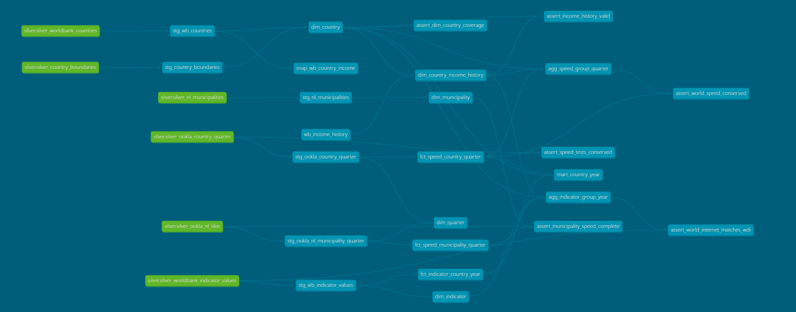

# Global & Dutch Digital Divide Lakehouse

[](https://github.com/FreeyaFly/digital-divide-lakehouse/actions/workflows/ci.yml)

An end-to-end data platform that measures the digital divide, from global country-level ICT indicators down to broadband quality in Dutch municipalities.

> Status: **Week 6 done: orchestration and CI**: one Airflow DAG runs the whole pipeline (extract, SAS rotation, Databricks jobs as code, dbt) in a locked task image; a failure test proves failures stop safely; CI checks code, dbt, the DAG, Terraform and secrets without cloud credentials; Terraform state is remote. Next: the Power BI report.

| Week | Scope | Status |
|---|---|---|
| 1 | Terraform foundation, Databricks Free Edition validation | ✅ |
| 2 | World Bank: API → ADLS → Bronze → Silver, incremental and idempotent | ✅ |
| 3 | Ookla: 8 quarters × fixed/mobile into Bronze (80 M rows); Dutch municipalities via H3 | ✅ |
| 4 | Ookla global country-level aggregation (Natural Earth + H3 tessellation), performance notes | ✅ |
| 5 | dbt Gold star schema, SCD2 income history (FY89–FY27) + snapshot, 54 tests | ✅ |
| 6 | Airflow 3 + Docker task image, Databricks Asset Bundle, GitHub Actions CI, remote Terraform state | ✅ |
| 7 | Power BI report | ⏳ |

## Architecture

```
            Terraform (Azure resources, pipeline identity, budget alert; remote state)
                              │
 World Bank API ─┐            ▼
 Ookla Parquet  ─┼─► Python ingest ─► Landing (ADLS Gen2 / UC Volume)
 CBS StatLine   ─┘   (Docker)                  │
                                               ▼
                     Databricks + Unity Catalog (Delta Lake)
                     Bronze ── PySpark ──► Silver ── dbt ──► Gold (star schema)
                                               │
                                               ▼
                                    Power BI Desktop (semantic model)

 Orchestration: Airflow 3 (WSL2) → task image (DockerOperator) + Databricks jobs (Asset Bundle)
 CI: GitHub Actions (ruff, pytest, dbt parse, DAG test, Terraform validate, gitleaks)
 Tests: pytest + dbt tests
```

## Data sources

| Source | Grain | Volume | Why it is here |
|---|---|---|---|
| [World Bank API](https://datahelpdesk.worldbank.org/knowledgebase/articles/889392) | country × year | ~100k rows | Incremental API ingestion; income-group reclassification drives an SCD2 snapshot |
| [Ookla Open Data](https://github.com/teamookla/ookla-open-data) | ~600 m tile × quarter | 80 M rows (8 quarters, fixed + mobile) | Distributed processing with PySpark, partitioned incremental loads |
| [PDOK Bestuurlijke Gebieden](https://api.pdok.nl/kadaster/bestuurlijkegebieden/ogc/v1) | Dutch municipality | 342 boundaries | Spatial join of speed tiles to municipalities via H3 |
| [Natural Earth Admin 0](https://www.naturalearthdata.com/downloads/10m-cultural-vectors/10m-admin-0-countries/) (1:10m, v5.1.2) | Country | 258 units | Exact global spatial join via H3 tessellation (core cells + border chips) |
| [CBS StatLine](https://opendata.cbs.nl/) | Dutch municipality | small | Local drill-down (optional) |

## Repository layout

```
infra/terraform/   Azure resources: resource group, ADLS Gen2, Key Vault, pipeline service
                   principal, budget alert
infra/bootstrap/   One-off script that creates the remote Terraform state storage
ingestion/         Python extractors (World Bank indicators, income history), SAS rotation
tests/             pytest unit tests (extractors, notebook helpers, tools)
notebooks/         Databricks notebooks (source format): validation, Bronze, Silver,
                   plus country_codes.py, a helper module imported by Notebook 34
tools/             Developer tools, e.g. exporting clean notebook run snapshots
transform/dbt/     dbt project: staging views, Gold star schema, SCD2, seed, snapshot
orchestration/     Airflow DAG and the script that sets its connections and variables
databricks.yml     Databricks jobs as code (Asset Bundle)
Dockerfile         Task image for the extractor, SAS rotation and dbt
.github/workflows/ CI and image build
docs/              Decision records (ADRs) and weekly checklists
docs/notebook-runs/  Executed notebook snapshots (.ipynb with outputs)
```

Design decisions are recorded in [ADR 0001: platform choice](docs/adr/0001-platform-choice.md), [ADR 0002: World Bank ingestion](docs/adr/0002-worldbank-ingestion.md), [ADR 0003: Ookla ingestion and Dutch municipalities](docs/adr/0003-ookla-ingestion.md), [ADR 0004: global country-level aggregation](docs/adr/0004-ookla-country-aggregation.md), [ADR 0005: dbt Gold layer](docs/adr/0005-dbt-gold.md) and [ADR 0006: orchestration, task image, CI and remote state](docs/adr/0006-orchestration.md).

## How to run (World Bank)

Prerequisites: Python 3.11+, Azure CLI signed in with a role that can write to the lake, Databricks CLI with a profile, and the Terraform outputs from `infra/terraform`.

```powershell
# 1. Install and test
python -m venv .venv
.\.venv\Scripts\Activate.ps1
pip install -e ".[dev]"
pytest

# 2. Land raw data: local folder first, then ADLS
python -m ingestion.worldbank --target local
$env:DDLAKE_STORAGE_ACCOUNT = "<storage-account-name>"
python -m ingestion.worldbank --target adls      # re-runs skip until WDI publishes a new release

# 3. Give Databricks a read/list SAS for the landing container (user delegation, max 7 days).
#    The Airflow pipeline does this on every run; the manual steps are for running without it.
$expiry = (Get-Date).ToUniversalTime().AddDays(6).ToString("yyyy-MM-ddTHH:mmZ")
$sas = az storage container generate-sas --account-name <storage-account-name> --name landing `
       --permissions rl --expiry $expiry --auth-mode login --as-user -o tsv
databricks secrets create-scope ddlake --profile <profile>          # once
databricks secrets put-secret ddlake adls-landing-sas --string-value $sas --profile <profile>
Remove-Variable sas

# 4. Import the notebooks, then run 10 and 20 on serverless compute
databricks workspace import "/Users/<you>/ddlake/10_worldbank_land_to_bronze" `
  --file notebooks/10_worldbank_land_to_bronze.py --language PYTHON --format SOURCE --overwrite --profile <profile>
databricks workspace import "/Users/<you>/ddlake/20_worldbank_bronze_to_silver" `
  --file notebooks/20_worldbank_bronze_to_silver.py --language PYTHON --format SOURCE --overwrite --profile <profile>
```

Notebook 10 needs the `storage_account` widget set. Both notebooks are idempotent: a second run copies, inserts and merges nothing.

**See the actual output:** [docs/notebook-runs/](docs/notebook-runs/) holds executed snapshots of the notebooks, exported with `tools/export_notebook_snapshot.py` (code identical to `notebooks/` on the export date, Databricks metadata stripped, scanned for identifiers). The 2026-10-05 snapshots are a re-run with a fake partial release planted in the lake, so they show both idempotency (0 rows copied, inserted or merged) and the partial-release guard (`not covered by the watermark: 1 files`); first-load numbers are in [ADR 0002](docs/adr/0002-worldbank-ingestion.md#results-wdi-release-2026-07-13). The 2026-10-11 snapshots show the first real incremental update (WDI release 2026-10-08): 428 values revised, 233 added, 0 removed, all on regional and income-group aggregates.

## How to run (Ookla and Dutch municipalities)

No Azure access or secrets are needed: Ookla and PDOK are public. Import the notebooks as above, then run them on serverless compute in order:

| Notebook | What it does | Typical run |
|---|---|---|
| `30_ookla_discovery` | One-quarter probe: size, schema, Spark timing, spatial functions | ~1 min |
| `31_ookla_land_to_bronze` | Latest 8 quarters × fixed/mobile into `bronze_ookla_tiles`; resumable; deletes raw files after reconciling | ~7 min first run, seconds afterwards |
| `32_nl_municipalities` | PDOK boundaries → `silver_nl_municipalities` and H3 cells | ~1 min |
| `33_ookla_nl_silver` | Dutch tiles → municipalities (H3 equi-join) → `silver_ookla_nl_tiles`, with an exact-method accuracy check | ~3 min |
| `34_country_boundaries` | Natural Earth countries → `silver_country_boundaries`, reconciled with WDI, cut into H3 resolution-5 chips (`silver_country_h3_chips`) | ~5 min |
| `35_ookla_country_silver` | Every tile → country (`silver_ookla_tile_country`, incremental) → `silver_ookla_country_quarter`, checked against an independent shapely assignment | ~2 min first run |

Notebook 34 imports `notebooks/country_codes.py`, so import that file into the same workspace folder as a workspace file:

```powershell
databricks workspace import "/Users/<you>/ddlake/country_codes.py" `
  --file notebooks/country_codes.py --format AUTO --overwrite --profile <profile>
```

Snapshots of the first runs are in `docs/notebook-runs/2026-10-11_3*` (week 3) and `docs/notebook-runs/2026-10-12_3*` (week 4).

## How to run (dbt Gold)

The Gold layer is built with dbt on the Databricks SQL warehouse ([ADR 0005](docs/adr/0005-dbt-gold.md)).

```powershell
# 1. Install dbt into the project environment
.venv\Scripts\python -m pip install -e ".[dev,transform]"

# 2. Connection: profiles.yml reads three user environment variables.
#    Token: Databricks > Settings > Developer > Access tokens, scope "sql" (BI Tools).
[Environment]::SetEnvironmentVariable("DBT_DATABRICKS_HOST", "<workspace-host>", "User")
[Environment]::SetEnvironmentVariable("DBT_DATABRICKS_HTTP_PATH", "/sql/1.0/warehouses/<warehouse-id>", "User")
[Environment]::SetEnvironmentVariable("DBT_DATABRICKS_TOKEN", (Read-Host "Paste token"), "User")

# 3. Build, test and document (open a new terminal first so the variables are loaded)
cd transform/dbt
..\..\.venv\Scripts\dbt debug
..\..\.venv\Scripts\dbt build          # seed, 17 models, snapshot, 54 tests
..\..\.venv\Scripts\dbt docs generate
```

The income history seed is regenerated each July, when the World Bank publishes a new fiscal year: `python -m ingestion.worldbank.income_history` (it stops if the workbook's SHA-256 changed, so the new release is reviewed first).



## How to run (orchestrated pipeline)

The weekly pipeline is one Airflow DAG ([ADR 0006](docs/adr/0006-orchestration.md)). Steps 1 and 2 run in Windows PowerShell, steps 3 to 5 in WSL2 (Ubuntu) with Docker Engine and Airflow 3.3 installed.

```powershell
# 1. Remote Terraform state (once per machine): create backend.hcl from the example, then
cd infra/terraform
terraform init "-backend-config=backend.hcl"       # quoted: PowerShell 5.1 splits -x=a.b at the dot

# 2. Deploy the Databricks jobs (ddlake_refresh weekly, ddlake_reference on demand)
cd ../..
$env:BUNDLE_VAR_storage_account = terraform -chdir=infra/terraform output -raw storage_account_name
databricks bundle deploy -p <profile>
```

```bash
# 3. Build the task image
docker build -t ddlake-tasks .

# 4. Airflow connections and variables (secrets are asked for with hidden input)
export AZURE_TENANT_ID=... AZURE_CLIENT_ID=... DDLAKE_STORAGE_ACCOUNT=... DDLAKE_REFRESH_JOB_ID=...
export DBT_DATABRICKS_HOST=... DBT_DATABRICKS_HTTP_PATH=...
bash orchestration/airflow/setup_connections.sh

# 5. Start Airflow once (one window), then run the DAG from another
airflow standalone
airflow dags unpause ddlake_refresh && airflow dags trigger ddlake_refresh
airflow dags pause ddlake_refresh                  # the DAG stays paused between scheduled weeks
```

A run takes about 10 minutes: extract (seconds when there is no new WDI release), SAS rotation, the Databricks job (about 9 minutes) and `dbt build`. A week without new data writes nothing. `airflow dags pause` / `unpause` print the state *before* the change.

Keep in mind:
- Rebuild the image (step 3) after changing `ingestion/` or `transform/dbt/`: the DAG runs `ddlake-tasks:latest`.
- The landing SAS is valid for 6 days after the last Airflow run. To run the Databricks job without Airflow after that, rotate it first (`python -m ingestion.landing_sas`, in the image or the local environment).
- Start `airflow standalone` only once; a second instance on the same SQLite database means two schedulers.

CI ([workflow](.github/workflows/ci.yml)) needs no secrets. To run the same checks locally: `ruff check .`, `pytest`, `dbt parse` in `transform/dbt` with placeholder `DBT_DATABRICKS_*` variables, and `terraform fmt -check -recursive` + `terraform validate`.

## Cost control

**Hard cap: under €1 for the whole project** (worst-case estimate: about €0.10).

- Heavy compute runs on Databricks Free Edition; Airflow and Docker run locally.
- The only billable Azure resources are ADLS Gen2, capped at 1 GB, Key Vault and the Terraform state account (about 50 KB).
- Azure budgets only alert, so the cap is enforced by the design rather than by monitoring. On top of that, Terraform adds a €1 budget alert at subscription scope (the subscription holds only this project, so it also covers the remote-state account) and pins Defender for Storage to the Free tier.
- `terraform destroy` removes everything except the state account (`rg-ddlake-tfstate`), which is deleted by hand once the state is no longer needed.

See the cost model in [docs/adr/0001-platform-choice.md](docs/adr/0001-platform-choice.md#cost-model).

## Attribution

- **World Bank, World Development Indicators**, licensed under [CC BY 4.0](https://creativecommons.org/licenses/by/4.0/). Within WDI, the internet, broadband and mobile indicators originate from the ITU World Telecommunication/ICT Indicators Database, and secure Internet servers from Netcraft. The historical income classification (`OGHIST.xlsx`) is a resource of the same WDI dataset.
- **Speed test data © Ookla**, 2019–present, licensed under [CC BY-NC-SA 4.0](https://creativecommons.org/licenses/by-nc-sa/4.0/).
- **Municipality boundaries © Kadaster** (Bestuurlijke Gebieden, via PDOK), licensed under [CC BY 4.0](https://creativecommons.org/licenses/by/4.0/).
- **Country boundaries: Made with Natural Earth.** Free vector and raster map data @ [naturalearthdata.com](https://www.naturalearthdata.com/) (public domain).
